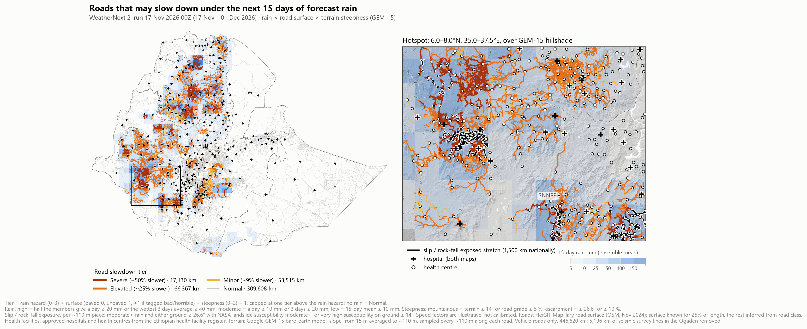
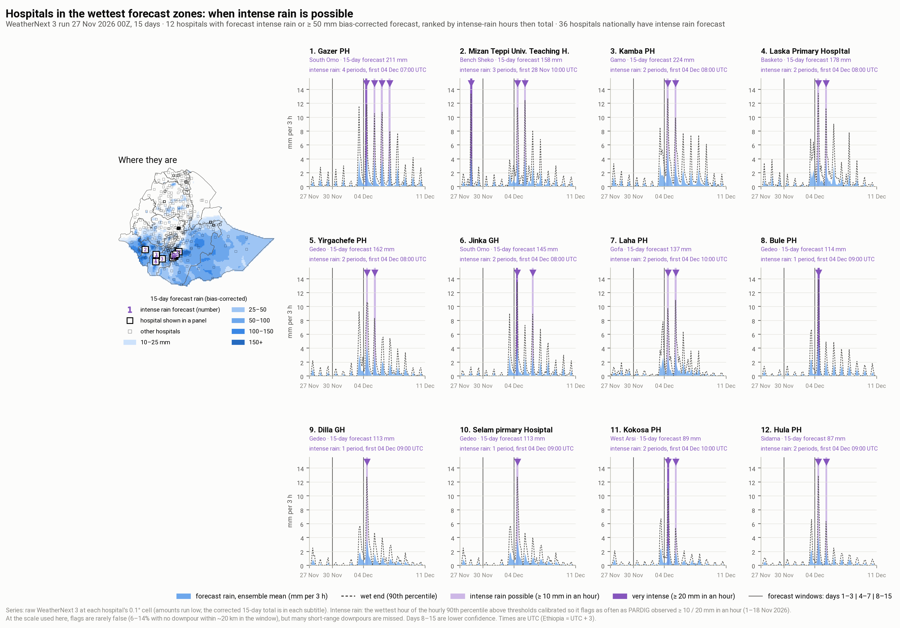

# Ethiopia rain, flooding and healthcare access forecast

**Interactive map:** https://aschroedercr.github.io/eth-health-access-roads/

This is an example of using a 15-day rainfall forecast to flag Ethiopian roads likely to slow down or become blocked. It also flags the health facilities whose referral trips get longest as a result. Each road segment is scored on three factors:

1. **Forecast rain:** Google WeatherNext 3 at 0.1°, via Earth Engine. Daily rain is bias-corrected against Google PARDIG observations, because the raw forecast gave only about half the rain that fell in a check against PARDIG.
2. **Roads and surface:** the road network is today's OpenStreetMap extract for Ethiopia (Geofabrik). Each road's surface (paved or unpaved, plus mapped condition) comes from HeiGIT's Mapillary-based road surface dataset, joined by OSM way id, or from the road's own OSM tag where HeiGIT doesn't have it.
3. **Terrain steepness:** Google GEM-15 bare-earth elevation, as road grade and ground slope.

The road network is then used to route every hospital, health centre and health post (about 19,700 approved facilities) under normal and forecast speeds. The same routing is also run on the Malaria Atlas Project's motorized friction surface, and the web map can switch between the two travel models.

The current outputs are for the **19 Nov 2026 00Z** WeatherNext 3 run, covering 19 Nov – 3 Dec 2026.






## Headline results (19 Nov 2026 run)

| | |
|---|---|
| Vehicle road network scored | ~334,000 km |
| Severe / Elevated / Minor slowdown, worst window | 58,513 / 62,375 / 51,760 km |
| Road stretches exposed to slips / rock fall, any window | ~890 km |
| **Trip to the nearest hospital:** health centres taking 30+ min longer | 579 of ~3,600 (224 take an hour or more); 135 on the MAP friction surface |
| **Trip to the nearest hospital:** health posts taking 30+ min longer | 2,776 of ~15,500 (947 on the MAP friction surface) |
| **Trip from a health post to its nearest health centre:** posts taking 30+ min longer | 389 of ~15,500 (245 on the MAP friction surface) |

The two trips are timed separately and their minutes aren't comparable: a health post's trip to its health centre is usually much shorter than a trip to a hospital. The web map colours one trip at a time (*Health facility access → Map colours show added minutes on one trip*).

The hardest-hit areas are the south-west highlands (Buno Bedele, Kefa, Sheka, Bench Sheko, Jimma, South Omo) and the Amhara highlands (North Gondar, West and East Gojam, South Gondar).

## Method

### Rain: accumulation and intensity, by forecast window
Rain is judged two ways, each for days 1–3, 4–7 and 8–15 (`charts/ETH_roads_rain_risk_windows.png`):
- **Accumulation** drives the slowdown tier. It is the wettest 10-day running total in the window, counting rain PARDIG observed before the forecast plus the bias-corrected forecast. Low ≥ 25 mm, moderate ≥ 50 mm, high ≥ 100 mm.
- **Intense rain** marks where a downpour is possible. It is the wettest hour of WeatherNext 3's hourly 90th percentile (`27_wn3_hourly.py`), with thresholds set so it flags as often as PARDIG observed ≥ 10 mm, or ≥ 20 mm, in an hour (1–18 Nov 2026; `28_pardig_hourly.py`, `29_calibrate_intensity.py`). Exact cell-days are hard to hit: about 15% hit rate, 86% false alarms, though still 8–10× better than random. At the scale the map uses it (per window, ~20 km tolerance), flags are rarely false: 6–14% false alarms. It catches 23% (days 1–3), 53% (4–7) and 67% (8–15) of observed downpour areas.
- The **overall** tier is the worst window, and drives routing. Slip / rock-fall exposure needs intense rain or high accumulation on steep, landslide-prone ground.

### Rain bias correction
**Why.** WeatherNext 3's rain forecast is the average of its ensemble runs, and averaging smooths rain out. Checked against PARDIG, Google's observed rainfall (`23_verify_wn3_pardig.py`), it gives 0.6–0.9 of the rain that falls and rarely forecasts a day ≥ 10 mm. The hazard rules use thresholds like "a day ≥ 10 mm", so the raw forecast would almost never trigger them.

**Method: quantile mapping.** Instead of scaling every value by one factor, the correction matches rankings: the forecast's 90th-percentile day is made equal to PARDIG's 90th-percentile day, and so on.
1. **Pairs.** For every cached WeatherNext 3 00 UTC run, each forecast day's rain in each 0.1° cell is paired with PARDIG's observed rain for that day and cell.
2. **Groups.** Bias depends on lead time and place, so pairs are split by forecast range (days 1–3, 4–7, 8–15) and by region (ADM1). A region with fewer than 3,000 observed wet cell-days (≥ 1 mm) in a group uses the all-Ethiopia mapping, because thin samples give unstable tails.
3. **Lookup table.** In each group the forecast values and the observed values are sorted separately and read off at the same 201 percentile levels, spaced more densely at the wet end. Each row pairs a forecast amount with the observed amount at the same percentile.
4. **Applying it.** Each forecast value is looked up in its group's table, interpolating between rows, and replaced by the matching observed amount. For example, if WeatherNext 3's top 5% of days run around 6 mm and PARDIG's around 18 mm, a 6 mm forecast becomes about 18 mm. Values above the table's top are scaled by the ratio at the top, and corrected rain is never negative.

**Two mappings, each used where it tested best** (`25_test_biascorr_seasons.py`, across Bega, Belg, Kiremt and the short rains of 2024–2026):

| | Hazard mapping (`24_bias_correct_wn3.py`) | Amounts mapping (`26_monthly_biascorr_wn3.py`) |
|---|---|---|
| Trained on | short-rains runs only: Oct–Dec 2025 (every third day) and Nov 2026 | every cached run, all years, with one table per calendar month that pools month M − 1, M and M + 1 (a month with too few pairs uses the all-months table) |
| Used for | the rain hazard classes that set road slowdown tiers | rain amounts: map layer, totals, road details, hospital charts, % of normal |
| Why | caught the most observed hazard in every season: 73–83% of the moderate-or-higher area in Belg and Kiremt, with 8–15% false alarms, including the dry Kiremt of 2026 | the hazard mapping overstates amounts 1.5–2.5× outside the short rains; this one is closer on totals in most seasons |

**Testing.** The amounts mapping was tested leave-one-year-out: for each year, tables were fitted on the other years and scored on that one. The hazard mapping was trained partly on this year's short rains, so its scores for those runs are in-sample and flattering.

**Limits.**
- About 2–3 years of WeatherNext 3 runs. Its bias varies by year, so amounts can be off by tens of per cent in a given season (Kiremt 2025: 1.9×, Kiremt 2026: 0.56× after correction).
- It corrects the distribution of rain, not its timing or location: a storm forecast in the wrong place stays in the wrong place, with more realistic amounts.
- Everything is corrected toward PARDIG, not CHIRPS. That matters mostly for counts of heavy-rain days, not for the 10-day totals behind the slowdown tiers (see *Rain compared with normal*).
- The intense-rain flag (≥ 10 / 20 mm in an hour) does not use this correction; its thresholds are set so WeatherNext 3's hourly forecast flags downpours as often as PARDIG observed them.

### Rain compared with normal
The web map can show rain as **% of normal** (switch under *Forecast rain*). It follows the forecast window, and the hospital card shows the same comparison at each hospital (`charts/ETH_rain_percent_of_normal.png`, `33_percent_of_normal.py`).
- **Normal:** CHIRPS v3 daily, 1991–2020, for the same calendar days (`31_chirps_normal.py`).
- **Same terms:** the forecast and the observed rain are both scaled to PARDIG, which runs drier than CHIRPS in these weeks. Each is divided by its region's PARDIG ÷ CHIRPS ratio for 4 Nov – 19 Dec 2023–25 (0.71–0.97) before comparing. Regions drier than 0.5 mm/day in those weeks use the national 0.81.
- **Not compared:** cells with a 15-day normal under 5 mm are dry season, and a few mm there swings the percentage wildly.
- **Terciles:** below / near / above normal is where the total falls among the 30 years. The forecast is an ensemble mean, which smooths away extremes, so "above normal" is if anything understated.
- **19 Nov 2026 run:** the last 10 days had 269% of normal. The next 15 days are forecast at 117%: dry for a week (days 1–3 35%, days 4–7 41%), then wet (days 8–15 236%).

**PARDIG vs CHIRPS for the short rains** (`32_pardig_vs_chirps_short_rains.py`, `charts/ETH_pardig_chirps_short_rains.png`). The forecast is corrected to PARDIG, not CHIRPS. Over Oct–Dec 2023–2025 the two agree on total rain (PARDIG 0.92× CHIRPS) and on 10-day totals ≥ 50 mm (0.95×), the accumulation classes that set the slowdown tier. They differ on heavy days: PARDIG has 0.80× CHIRPS's days ≥ 20 mm overall, 0.54× in Somali, and 1.37× in Amhara and Tigray. Correcting to CHIRPS would add heavy-rain days in the south-east and remove some in the north; the slowdown tiers would change little.

### Road slowdown tier
Each road segment's tier, per window, is **accumulation (0–3) + surface (0–2) + steepness (0–2) − 1**, kept between 0 and 3. A road can be at most one tier above its rain score, and a road with no forecast rain is always Normal.

| Factor | Levels |
|---|---|
| Rain (bias-corrected) | **high:** a day ≥ 20 mm, or the wettest 3 days ≥ 40 mm<br>**moderate:** a day ≥ 10 mm, or 3 days ≥ 20 mm<br>**low:** 15 days ≥ 10 mm |
| Surface | paved 0, unpaved 1, plus 1 if OSM tags the condition as bad / very bad / horrible / impassable. Surface is mapped for about 20% of road length; the rest is inferred from road class. |
| Steepness | Based on the Ethiopian Roads Authority terrain classes:<br>**mountainous:** ground slope ≥ 14° or road grade ≥ 5%<br>**escarpment:** ground slope ≥ 26.6° or road grade ≥ 10% |

- **Rain bias correction:** forecast rain is corrected toward observed rain before any of these levels are applied; see *Rain bias correction* above.
- **Tiers and assumed speeds:** Normal, Minor (~10% slower), Elevated (~25% slower), Severe (~50% slower).
- **Slip / rock-fall exposure:** judged on each ~110 m piece of road, not the whole segment. A piece is exposed when the forecast rain over it is moderate or high, and either the ground is ≥ 26.6° where NASA's global landslide susceptibility map rates it moderate or higher, or susceptibility is very high on ground ≥ 14°. Only the exposed stretches are counted (km) and drawn on the maps. The flag is reported separately and doesn't change the slowdown tier.
- **Flood exposure** (`38_flood_exposure.py` once, then `14_` each run; `charts/ETH_roads_flood_windows.png`): two kinds of place, each flagged per forecast window and reported separately (not used in travel times).
  - *Low-lying stretches:* a ~110 m piece of road no more than 3 m above the nearest drainage with a river draining ≥ 100 km² within 1 km (MERIT Hydro height above nearest drainage and upstream area), or ground JRC Global Surface Water saw under water ≥ 10% of the time (1984–2021) and ≤ 5 m above drainage. About 7% of road length qualifies; it is flagged when the window's 10-day running rain reaches 50 mm or very intense rain is possible.
  - *River crossings:* every place a vehicle road meets an OSM river, stream, canal or drain (14,377), plus crossings of MERIT channels draining ≥ 50 km² where OSM maps no waterway (18,108). Each is classed by what OSM maps: bridge, culvert, ford (way tag or ford node within 30 m), or nothing; on trunk, primary and secondary roads nothing mapped is assumed to be a bridge. Only crossings with a flood risk in the window are shown:
    - *Rivers GloFAS resolves* (`39_glofas_crossings.py`): each crossing on a river draining ≥ 250 km² is matched to a GloFAS river cell (within ~11 km, upstream area within a factor of 2 of MERIT's; 8,033 of 8,047 match, median area difference 2%). The day's GloFAS 51-member river-flow forecast (Copernicus Emergency Management Service) gives, for each window, the share of members above the GloFAS v4 2-, 5- and 20-year flood on the worst day. A ford, unbridged crossing or culvert is shown when ≥ 30% exceed the 2-year flood (graded 5- and 20-year); a bridge only when ≥ 30% exceed the 20-year flood. This counts rain falling anywhere upstream. Rivers whose GloFAS 2-year flood is under 10 m³/s (dry beds in the model, mostly in the Somali region, where any flow counts as a "flood") are left to the next rule.
    - *River flow forecast points:* the web map's "River flow forecast (GloFAS)" layer marks 549 points along rivers draining ≥ 2,000 km² (one per 0.25°, on the largest river there; named from the nearest OSM river), hollow when there is no flood signal and filled by the likeliest flood level (≥ 30% of members above the 2-, 5- or 20-year flood) in the selected window. Clicking one opens a card with the chance of each flood level by window and the 15-day hydrograph: ensemble median, middle 80% of the 51 members, and the flood levels. Flood-risk crossings on GloFAS rivers show the same hydrograph.
    - *Smaller streams:* fords and unbridged crossings only where very intense rain is possible and the 10-day rain reaches 100 mm (flash floods).
    - If GloFAS is unavailable for a run, every crossing falls back to the flash-flood rule and the daily report says so. Forecast access needs the CEMS Early Warning Data Store terms and the CEMS-FLOODS licence accepted on the Copernicus account.
  - On the 23 Nov run: 1,164 km of low-lying road flagged in at least one window, most in days 8–15. GloFAS shows no river near flood level (dry season: the median river peaks at under a tenth of its 2-year flood), so the 36 crossings shown are flash-flood setups in days 8–15.
  - Limits: thresholds are first guesses, not yet checked against observed road floods; rain is taken at the road, not over the catchment upstream, for low-lying stretches (GloFAS covers upstream rain at river crossings only); many unmapped crossings will in fact have a bridge or culvert. Observed flood extents are the next step for checking the thresholds.
- **Population profile of a hospital's network** (`40_woreda_population.py` once, then `16_`): clicking a hospital adds a profile to its card and outlines the network's footprint on the map: a rectangle on the mean centre of the hospital and its linked health centres and posts, with half-widths of 2 standard deviations of their east–west and north–south positions, plus about 2 km; any side a facility lies beyond is pushed out to that facility plus the margin, so every linked facility is inside. The card lists the woredas the footprint overlaps (OCHA COD-AB 2025, 1,148 woredas) with WorldPop 2020 population and children under 5 (ages 0 and 1–4; constrained 100 m grid, summed per woreda on Earth Engine), their totals, the population inside the footprint itself (WorldPop's 100 m cells within the footprint, split by woreda, summed on Earth Engine and cached per footprint so daily runs only compute new or changed footprints; area share is the fallback if Earth Engine fails), and the flood flags (low-lying road km, river crossings at risk) inside it for the selected window — a network with any is marked flood-affected. WorldPop's constrained 2020 counts are not adjusted to UN totals (98.8 million nationally against UN estimates near 120 million), so the figures are best read relative to one another. The profile is computed when a hospital is clicked; it is not a map layer. Table: `tables/eth_woreda_population_2020.csv`.
- **Removed:** about 4,700 km of seismic survey cut-lines in the Ogaden that OSM maps as tracks, and 361 ways (246 km) that OSM tags as under construction, no access, no motor vehicles or impassable.
- **Road network history:** until 19 Nov 2026 the network was the HeiGIT file itself. That file repeats about 90,000 rows verbatim, which counted ~28% of road length twice and made trips about 1.5× too long; it stops at July 2024 and lacks about 8% of today's OSM road length, including stretches of the A10 and B90; and it carries no construction or access tags. The per-facility OSRM check (below) traced its worst outliers to these gaps, so the network now comes from the current OSM extract, with HeiGIT used for surface only.

### Health facility access
- **Road graph:** every road vertex is a node. Dead ends within 30 m of another road are linked to it.
- **Normal speeds:** trunk 70, primary 60, secondary 50, tertiary 40, minor roads 30, residential 20, tracks 15 km/h. Unpaved roads run at 70% of that, and the roughest roads (track grade 5, or a sand or mud surface; about 2,600 km) at a further 60%.
- **Forecast speeds:** normal speed × the road's tier factor.
- **Joining the network:** facilities connect to the nearest road vertex, covering the gap at 5 km/h. Those more than 10 km from a mapped road are flagged and left out of the rankings.
- **Assignment:** each facility is assigned its nearest hospital by road at normal speeds. Health posts are also assigned their nearest health centre.
- **Two trips:** every health centre and health post is timed to its nearest hospital. Health posts are also timed, separately, to their nearest health centre. Results are always reported per trip, never pooled.
- **Added minutes:** the forecast time minus the normal time for that same trip.
- **By forecast window:** every trip is timed for each window (days 1–3, 4–7, 8–15) with that window's own road tiers, and for "all 15 days", which uses each road's worst tier and gives the headline numbers. The web map's window switch changes the facility colours, the counts, the lists and the cards. Health centres 30+ min longer to reach their hospital: 485 (days 1–3), 129 (days 4–7), 265 (days 8–15), 579 (worst window).
- **15-day mean, by region** (`36_region_access_charts.py`): the day-weighted mean of a health centre's added minutes to its hospital over the 15 days, (3 × days 1–3 + 4 × days 4–7 + 8 × days 8–15) ÷ 15. `charts/ETH_hc_access_regions.png` compares the 13 regions of the facility register; `charts/regions/ETH_hc_access_<region>.png` gives each region a map, the windows and its most affected centres. South West Ethiopia stands out (mean +40 min; 58 of 127 centres 30+ min longer), then Amhara (+12 min; 107 of 844). Tables: `tables/eth_hc_access_by_region_20261119.csv`, `tables/eth_hc_access_15day_mean_20261119.csv`.
- **Linked facilities:** a hospital's linked facilities are the health centres and posts for which it is the nearest hospital, each counted on its own trip to that hospital. This is a road-network grouping, not a population catchment or the official referral pathway.
- **Check against a standard router** (`34_ors_check.py --router osrm`, `charts/ETH_osrm_check.png`): 200 health centre / post → hospital trips, stratified by region and trip length, routed on the public OSRM car profile with our walking legs removed. Routes come out the same length and rank the same way (rank correlation 0.98). Our normal times run about 1.3× OSRM's (middle half 1.18–1.40), as expected: we slow unpaved roads to 70%, and about three-quarters of route length is unpaved, while OSRM drives untagged roads at full speed. The same script runs against openrouteservice with `--router ors` and an API key in `ORS_API_KEY` or `~/.ors_key`.
- **Every facility against OSRM** (`35_osrm_facility_check.py`, `charts/ETH_osrm_facility_check.png`, `tables/eth_osrm_facility_check_20261119.csv`): all 18,957 hospital trips and 15,373 health post → health centre trips, timed with OSRM's table service (~540 batched requests). 87% of hospital trips and 85% of post → centre trips fall within 25% of the typical ratio (1.27 and 1.26), rank correlation 0.97–0.98. Flagged for review: 9 + 15 trips where ours is far slower (ratio > 2.5× typical and 30+ min more) and 51 + 98 where OSRM is far slower (< 0.4× typical and 30+ min less). On the old HeiGIT network the flags were 83 + 28 and 83 + 149; the clusters around Karamara (Jijiga), Warder, Urmadag, Chilaloshed, Bokoji and Tegede are gone. The largest left is 16 posts going to Macha Health Center (Konta): their road, "Feleke Selam – Amaya", is tagged *dry weather* and *track grade 5* and stops about 18 m short of the network in OSM. Our 30 m gap-closing links join it; OSRM cannot.
- **The forecast slowdowns on an independent router** (`37_graphhopper_rain_check.py`, `charts/ETH_graphhopper_rain_check.png`, `tables/eth_graphhopper_rain_check_20261120.csv`): OSRM only checks normal times, so this gives the same forecast road tiers to GraphHopper 11.1 (run locally on the same OSM extract, with its own car speeds and no slope) and times every health centre → hospital and health post → health centre trip normally and under each forecast window. Each road's tier travels in its OSM `hgv` tag, which the car profile never reads; GraphHopper's speeds are then multiplied by 0.9 / 0.75 / 0.5 on Minor / Elevated / Severe roads, as in our model. On the 20 Nov run:
  - The same trips are hit, in the same order: rank correlation of added minutes 0.99 for both trips in every window; 82% of hospital trips and 93% of post → centre trips agree within 5 min or 25%.
  - The slowdown as a share of the normal trip is the same: median 15% on both routers for centre → hospital, 12% (ours) vs 14% for post → centre.
  - GraphHopper's added minutes are smaller because its normal trips are faster (ours are 1.47× its time for centre → hospital, 1.75× for post → centre: it drives unpaved roads faster and has no slope). So it counts fewer facilities over 30 min: 366 health centres to 524, and 91 health posts to 261; nearly all of its 30+ centres (359 of 366) are also ours. The regional ranking holds (Amhara, Oromia, SNNP, South West Ethiopia).
  - The 30-minute counts therefore carry the uncertainty of the base speeds; which facilities are hit, and by how much relative to their normal trip, does not depend on the router. Not compared: 1,693 trips (mostly health posts) whose facility lies several km from any road, which GraphHopper will not snap to (median 2.7 km).
  - Runs with each daily update (a failure there is logged as a warning and does not hold back the rest). Needs Java 17+ and the GraphHopper web jar (`GH_HOME`, default `~/tools`); its tagged extracts and graphs (~1.2 GB, only the latest run kept) go to `GH_WORK` (default `~/tools/graphhopper/work`). Tagging, four graph builds and routing take about 10 minutes.

### Caveats
- Thresholds and speed factors are illustrative and haven't been checked against observed travel times or closures.
- Road grades come from a ~110 m elevation grid, so they run high where roads cut across hillsides.
- The bias corrections rest on 2–3 years of WeatherNext 3 runs; Bega (dry-season) hazard is caught poorly by any version (about a third, with 40–55% false alarms). PARDIG itself ran about 11% wetter than CHIRPS over the past year, but about 8% drier in the short rains (see *Rain compared with normal*).
- Absolute delays depend on the travel surface. Rerun on the Malaria Atlas Project motorized friction surface (`20_friction_access.py`), the same health centres come out most affected (rank correlation 0.96) with similar percentage slowdowns. But MAP's baseline trips are about 2.3 times shorter, so far fewer cross a fixed 30-minute threshold (`charts/ETH_friction_vs_road_*.png`).
- The landslide susceptibility map is ~1 km, so it describes the hillside setting, not the road cut itself.
- Routing is by road only. Seasonal river crossings, ferries and closures aren't modelled.

## Repository layout
```
docs/                 GitHub Pages site (index.html + data/)
scripts/
  11_weathernext_forecast.py   shared helpers (grid, boundaries, chart style); WeatherNext 2 fetch
  21_weathernext3_forecast.py  WeatherNext 3 15-day run for Ethiopia as daily mean / p50 / p90 (Earth Engine)
  22_calibrate_wn3_hazard.py   wet-end thresholds matched to the WeatherNext 2 member rule (fallback)
  23_verify_wn3_pardig.py      WeatherNext 3 vs PARDIG, early November 2026
  24_bias_correct_wn3.py       quantile-mapping bias correction; short-rains mapping used for hazard classes
  27_wn3_hourly.py             hourly WeatherNext 3 mean / p90 for intense-rain hazard
  28_pardig_hourly.py          observed wettest hour per day from PARDIG 15-min frames
  29_calibrate_intensity.py    intense-rain thresholds and their skill
  25_test_biascorr_seasons.py  test across Belg / Kiremt seasons, incl. the dry 2026 Kiremt
  26_monthly_biascorr_wn3.py   year-round monthly mapping (leave-one-year-out test) used for rain amounts
  14_roads_rain_risk.py        score road segments; static maps and charts
  15_fetch_gem15_dem.py        GEM-15 elevation + 15 m slope on a ~110 m grid (Earth Engine)
  16_export_webmap.py          compact web-map data files
  17_health_access.py          routing, facility rankings, charts
  18_build_webmap.py           build webmap/index.html (artifact) and docs/index.html (Pages)
  08_fetch_pardig_chirps.py    PARDIG and CHIRPS v3 daily on one 0.1° grid (Earth Engine)
  31_chirps_normal.py          CHIRPS 1991–2020 daily for the run's calendar days (Earth Engine)
  32_pardig_vs_chirps_short_rains.py  PARDIG vs CHIRPS over the short rains; PARDIG ÷ CHIRPS ratios
  33_percent_of_normal.py      forecast and observed rain as % of normal, with terciles
  30_hospital_rain_charts.py   forecast rain charts for hospitals in the wettest zones, with intense-rain periods
  19_travel_surface_compare.py compare with MAP 2020 motorized travel time (north-west clip)
  20_friction_access.py        rerun facility routing on the MAP motorized friction surface
  34_ors_check.py              normal-speed trip times vs a standard router (OSRM demo server or openrouteservice)
  35_osrm_facility_check.py    every facility's trips vs OSRM, with outlier flags
  36_region_access_charts.py   per-region charts and maps: health centre → hospital added time by window and 15-day mean
  37_graphhopper_rain_check.py the forecast slowdowns on GraphHopper with the same road tiers, against our added minutes
  38_flood_exposure.py         static flood exposure: MERIT Hydro / JRC surface water grid, river crossings and fords (run once)
  39_glofas_crossings.py       GloFAS river-flow ensemble at the crossings: chance of a 2-, 5- and 20-year flood per window
  40_woreda_population.py      woreda boundaries (OCHA COD-AB) with WorldPop 2020 population and under-5 counts (run once)
webmap/index.src.html  web map source (MapLibre GL)
charts/               PNG outputs
tables/               CSV outputs (per region, per facility, top lists, woredas)
assets/fonts/roboto/  Roboto (Apache 2.0), registered by the chart scripts so charts render the same everywhere
```

## Reproducing
Requires Python 3.12 with the packages in `requirements.txt` and an Earth Engine project (`earthengine authenticate`).

```bash
set EE_PROJECT=your-ee-project
python scripts/21_weathernext3_forecast.py        # latest 00Z WeatherNext 3 run
python scripts/24_bias_correct_wn3.py              # one-off; needs WN3 runs for the training dates and PARDIG (10_)
python scripts/15_fetch_gem15_dem.py               # one-off, ~1,600 tiles
python scripts/27_wn3_hourly.py --init YYYY-MM-DD    # hourly fields for the run being scored
python scripts/14_roads_rain_risk.py
python scripts/17_health_access.py
python scripts/20_friction_access.py               # optional: MAP friction model for the web map switch
python scripts/16_export_webmap.py
python scripts/18_build_webmap.py
```

These inputs aren't included; place them under `data/` first:
- `data/raw/osm/ethiopia-<yymmdd>.osm.pbf`: current [Geofabrik extract for Ethiopia](https://download.geofabrik.de/africa/ethiopia.html) (~140 MB). The newest file in the folder is used.
- `data/raw/roads/heigit_eth_roadsurface_lines.geojson`: [HeiGIT road surface, Ethiopia](https://downloads.ohsome.org/hdx/mapillary_road_surface/heigit_eth_roadsurface_lines.geojson) (HDX).
- `data/raw/boundaries/geoboundaries_adm1/ETH_ADM1.geojson`: [geoBoundaries](https://www.geoboundaries.org/) Ethiopia ADM1.
- `data/raw/landslide/global-landslide-susceptibility-map-2-27-23.tif`: [NASA global landslide susceptibility map](https://gpm.nasa.gov/sites/default/files/downloads/global-landslide-susceptibility-map-2-27-23.tif) (2023 version).
- `data/raw/friction/map_friction_motorized_2019_v5_1_eth.tif` (optional, for 20_): MAP motorized friction 2019 v5.1 from Earth Engine `projects/malariaatlasproject/assets/accessibility/friction_surface/2019_v5_1`.
- `data/health_facilities/ethiopian-health-facilities.csv`: Ethiopian health facility register, with columns `Id, Name, Latitude, Longitude, Type, Status, admin1Name, admin2Name, admin3Name, …`.

## Data sources and attribution
- Roads: © [OpenStreetMap contributors](https://www.openstreetmap.org/copyright), available under the ODbL. Road network from the Geofabrik OpenStreetMap extract of 19 Nov 2026. The road surface model is by HeiGIT (Heidelberg Institute for Geoinformation Technology). The road data in `docs/data/` is derived from OSM and is under the ODbL.
- Elevation: Google GEM-15 (Earth Engine, `projects/climate-and-sustainability/assets/gem-15_v1`).
- Landslide susceptibility: NASA Goddard Space Flight Center global landslide susceptibility map (Stanley & Kirschbaum, 2017, *Natural Hazards*; 2023 update), from the [GPM landslides page](https://gpm.nasa.gov/landslides/projects.html).
- Rain forecast: Google WeatherNext 3 (Earth Engine, `projects/gcp-public-data-weathernext/assets/weathernext_3_0_0_0p1deg`). WeatherNext 2 (`weathernext_2_0_0`) was used for calibration.
- Travel time / friction: Malaria Atlas Project (Weiss et al. 2020, *Nature Medicine*), for the alternative travel model and comparisons.
- Observed rainfall: Google PARDIG (Earth Engine `PARDIG_1_NRT` and `gs://pardig_1`), for verification and bias correction.
- Region boundaries: geoBoundaries (CC BY 4.0).
- Health facilities: Ethiopian health facility register.
- Map rendering: [MapLibre GL JS](https://maplibre.org/) (BSD-3-Clause).
