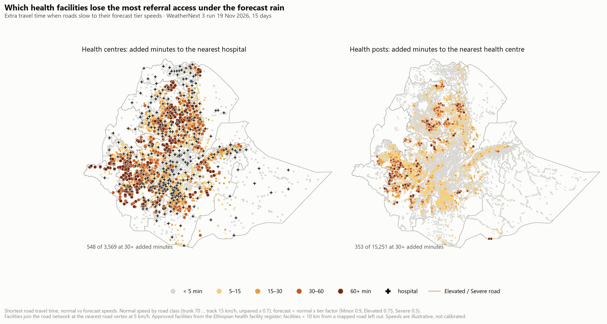
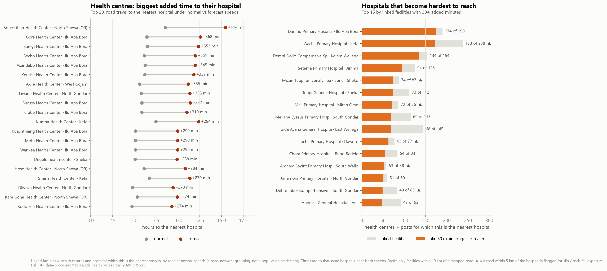

# Ethiopia: roads and health facility access under forecast rain

**Interactive map:** https://aschroedercr.github.io/eth-health-access-roads/

This is an example of using a 15-day rainfall forecast to flag Ethiopian roads likely to slow down or become blocked. It also flags the health facilities whose referral trips get longest as a result. Each road segment is scored on three factors:

1. **Forecast rain:** Google WeatherNext 3 at 0.1°, via Earth Engine (ensemble mean and percentiles, hourly, 15 days).
2. **Road surface:** paved or unpaved, plus mapped condition. From HeiGIT's Mapillary-based road surface dataset (OpenStreetMap).
3. **Terrain steepness:** Google GEM-15 bare-earth elevation, as road grade and ground slope.

The road network is then used to route every hospital, health centre and health post (about 19,700 approved facilities) under normal and forecast speeds.

The current outputs are for the **19 Nov 2026 00Z** WeatherNext 3 run, covering 19 Nov – 3 Dec 2026.





## Headline results (19 Nov 2026 run)

| | |
|---|---|
| Vehicle road network scored | ~447,000 km |
| Severe / Elevated / Minor slowdown | 24,850 / 104,463 / 105,746 km |
| Road stretches exposed to slips / rock fall | ~1,630 km |
| Health centres taking 30+ min longer to reach their nearest hospital | 548 of ~3,600 (233 take an hour or more) |
| Health posts taking 30+ min longer to reach their nearest health centre | 353 |

The hardest-hit areas are the south-west highlands (Ilu Aba Bora, Kefa, Sheka, Bench Sheko, Jimma) and the Amhara highlands (North Gondar, West and East Gojam, South Gondar).

## Method

### Road slowdown tier
Each road segment's tier is **rain (0–3) + surface (0–2) + steepness (0–2) − 1**, kept between 0 and 3. A road can be at most one tier above its rain score, and a road with no forecast rain is always Normal.

| Factor | Levels |
|---|---|
| Rain | **high:** the wettest day's wet end (90th percentile) ≥ 24 mm, or the wettest 3 days of the ensemble mean ≥ 40 mm<br>**moderate:** wet end ≥ 13 mm, or 3 days ≥ 20 mm<br>**low:** 15-day ensemble mean ≥ 10 mm |
| Surface | paved 0, unpaved 1, plus 1 if OSM tags the condition as bad / very bad / horrible / impassable. Surface is mapped for about 25% of road length; the rest is inferred from road class. |
| Steepness | Based on the Ethiopian Roads Authority terrain classes:<br>**mountainous:** ground slope ≥ 14° or road grade ≥ 5%<br>**escarpment:** ground slope ≥ 26.6° or road grade ≥ 10% |

- **Rain thresholds:** WeatherNext 3 publishes percentiles, not ensemble members. The original rule used 64 WeatherNext 2 members ("half the members give a day ≥ 10 / 20 mm"). The 13 and 24 mm wet-end thresholds were set by `22_calibrate_wn3_hazard.py` so that, on the 1, 16 and 17 Nov 00Z runs both models made, WeatherNext 3 flags the same share of Ethiopia as the member rule. Cells agree 90–97% on moderate or higher (`tables/wn3_hazard_calibration.csv`). The wet end sums the hourly 90th percentiles over a day, so it is an envelope, not a true daily percentile.
- **Tiers and assumed speeds:** Normal, Minor (~10% slower), Elevated (~25% slower), Severe (~50% slower, may be impassable).
- **Slip / rock-fall exposure:** judged on each ~110 m piece of road, not the whole segment. A piece is exposed when the forecast rain over it is moderate or high, and either the ground is ≥ 26.6° where NASA's global landslide susceptibility map rates it moderate or higher, or susceptibility is very high on ground ≥ 14°. Only the exposed stretches are counted (km) and drawn on the maps. The flag is reported separately and doesn't change the slowdown tier.
- **Removed:** about 5,200 km of seismic survey cut-lines in the Ogaden that OSM maps as tracks.

### Health facility access
- **Road graph:** every road vertex is a node. Dead ends within 30 m of another road are linked to it.
- **Normal speeds:** trunk 70, primary 60, secondary 50, tertiary 40, minor roads 30, residential 20, tracks 15 km/h. Unpaved roads run at 70% of that.
- **Forecast speeds:** normal speed × the road's tier factor.
- **Joining the network:** facilities connect to the nearest road vertex, covering the gap at 5 km/h. Those more than 10 km from a mapped road are flagged and left out of the rankings.
- **Assignment:** each facility is assigned its nearest hospital by road at normal speeds. Health posts are also assigned their nearest health centre.
- **Added minutes:** the forecast time minus the normal time for that same trip.
- **Linked facilities:** a hospital's linked facilities are the health centres and posts for which it is the nearest hospital. This is a road-network grouping, not a population catchment or the official referral pathway.

### Caveats
- Thresholds and speed factors are illustrative and haven't been checked against observed travel times or closures.
- Road grades come from a ~110 m elevation grid, so they run high where roads cut across hillsides.
- In an earlier check, WeatherNext 2 under-forecast observed rainfall (Google PARDIG) in early November 2026. WeatherNext 3 hasn't been checked against observations yet.
- Absolute delays depend on the travel surface. Rerun on the Malaria Atlas Project motorized friction surface (`20_friction_access.py`), the same health centres come out most affected (rank correlation 0.9) with similar percentage slowdowns. But MAP's baseline trips are about 3.8 times shorter, so far fewer cross a fixed 30-minute threshold (`charts/ETH_friction_vs_road_*.png`).
- The landslide susceptibility map is ~1 km, so it describes the hillside setting, not the road cut itself.
- Routing is by road only. Seasonal river crossings, ferries and closures aren't modelled.

## Repository layout
```
docs/                 GitHub Pages site (index.html + data/)
scripts/
  11_weathernext_forecast.py   shared helpers (grid, boundaries, chart style); WeatherNext 2 fetch
  21_weathernext3_forecast.py  WeatherNext 3 15-day run for Ethiopia as daily mean / p50 / p90 (Earth Engine)
  22_calibrate_wn3_hazard.py   wet-end thresholds matched to the WeatherNext 2 member rule
  14_roads_rain_risk.py        score road segments; static maps and charts
  15_fetch_gem15_dem.py        GEM-15 elevation + 15 m slope on a ~110 m grid (Earth Engine)
  16_export_webmap.py          compact web-map data files
  17_health_access.py          routing, facility rankings, charts
  18_build_webmap.py           build webmap/index.html (artifact) and docs/index.html (Pages)
  19_travel_surface_compare.py compare with MAP 2020 motorized travel time (north-west clip)
  20_friction_access.py        rerun facility routing on the MAP motorized friction surface
webmap/index.src.html  web map source (MapLibre GL)
charts/               PNG outputs
tables/               CSV outputs (per region, per facility, top lists, woredas)
```

## Reproducing
Requires Python 3.12 with the packages in `requirements.txt` and an Earth Engine project (`earthengine authenticate`).

```bash
set EE_PROJECT=your-ee-project
python scripts/21_weathernext3_forecast.py        # latest 00Z WeatherNext 3 run
python scripts/22_calibrate_wn3_hazard.py          # one-off; needs matching WN2 + WN3 runs (11_ and 21_ --init)
python scripts/15_fetch_gem15_dem.py               # one-off, ~1,600 tiles
python scripts/14_roads_rain_risk.py
python scripts/17_health_access.py
python scripts/16_export_webmap.py
python scripts/18_build_webmap.py
```

These inputs aren't included; place them under `data/` first:
- `data/raw/roads/heigit_eth_roadsurface_lines.geojson`: [HeiGIT road surface, Ethiopia](https://downloads.ohsome.org/hdx/mapillary_road_surface/heigit_eth_roadsurface_lines.geojson) (HDX).
- `data/raw/boundaries/geoboundaries_adm1/ETH_ADM1.geojson`: [geoBoundaries](https://www.geoboundaries.org/) Ethiopia ADM1.
- `data/raw/landslide/global-landslide-susceptibility-map-2-27-23.tif`: [NASA global landslide susceptibility map](https://gpm.nasa.gov/sites/default/files/downloads/global-landslide-susceptibility-map-2-27-23.tif) (2023 version).
- `data/raw/friction/map_friction_motorized_2019_v5_1_eth.tif` (optional, for 20_): MAP motorized friction 2019 v5.1 from Earth Engine `projects/malariaatlasproject/assets/accessibility/friction_surface/2019_v5_1`.
- `data/health_facilities/ethiopian-health-facilities.csv`: Ethiopian health facility register, with columns `Id, Name, Latitude, Longitude, Type, Status, admin1Name, admin2Name, admin3Name, …`.

## Data sources and attribution
- Roads: © [OpenStreetMap contributors](https://www.openstreetmap.org/copyright), available under the ODbL. The road surface model is by HeiGIT (Heidelberg Institute for Geoinformation Technology). The road data in `docs/data/` is derived from OSM and is under the ODbL.
- Elevation: Google GEM-15 (Earth Engine, `projects/climate-and-sustainability/assets/gem-15_v1`).
- Landslide susceptibility: NASA Goddard Space Flight Center global landslide susceptibility map (Stanley & Kirschbaum, 2017, *Natural Hazards*; 2023 update), from the [GPM landslides page](https://gpm.nasa.gov/landslides/projects.html).
- Rain forecast: Google WeatherNext 3 (Earth Engine, `projects/gcp-public-data-weathernext/assets/weathernext_3_0_0_0p1deg`). WeatherNext 2 (`weathernext_2_0_0`) was used for calibration.
- Travel time / friction: Malaria Atlas Project (Weiss et al. 2020, *Nature Medicine*), used for comparison only.
- Region boundaries: geoBoundaries (CC BY 4.0).
- Health facilities: Ethiopian health facility register.
- Map rendering: [MapLibre GL JS](https://maplibre.org/) (BSD-3-Clause).
